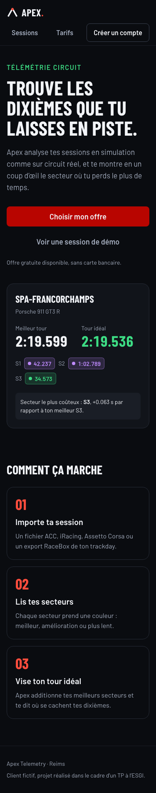
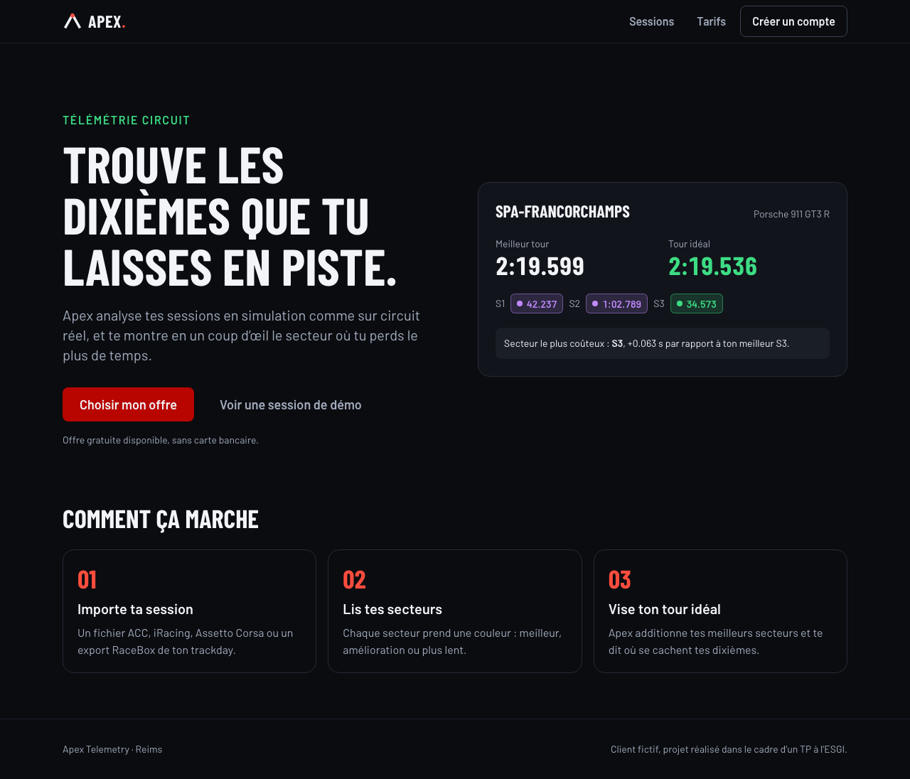
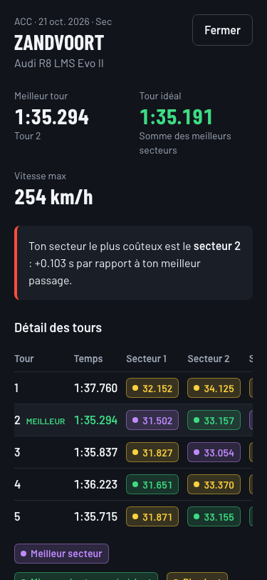
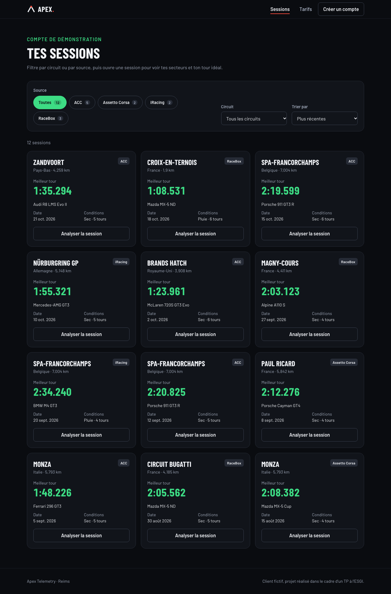
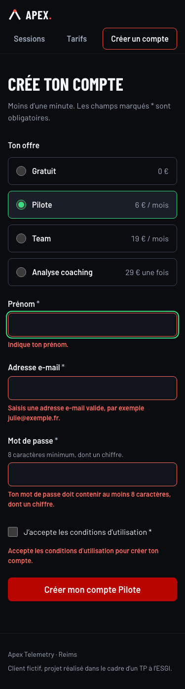
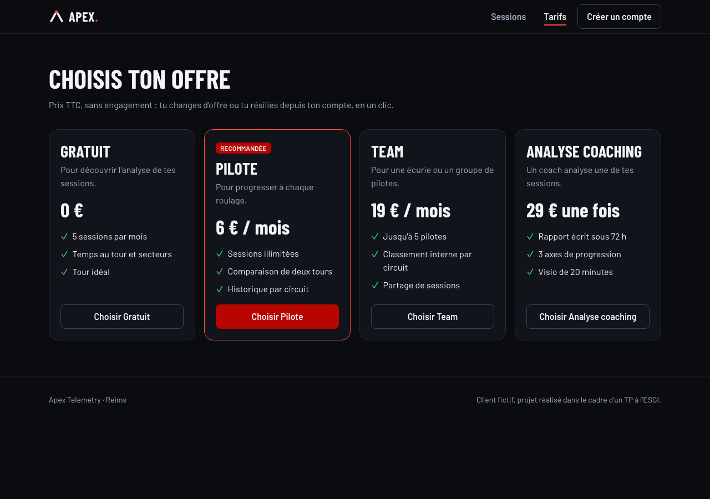
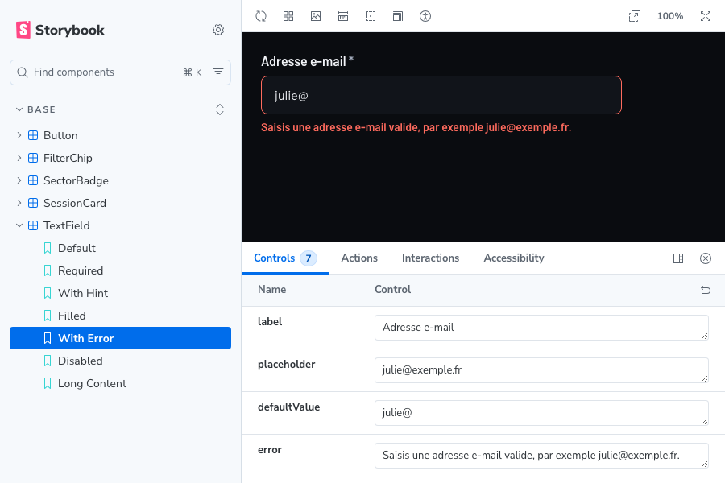
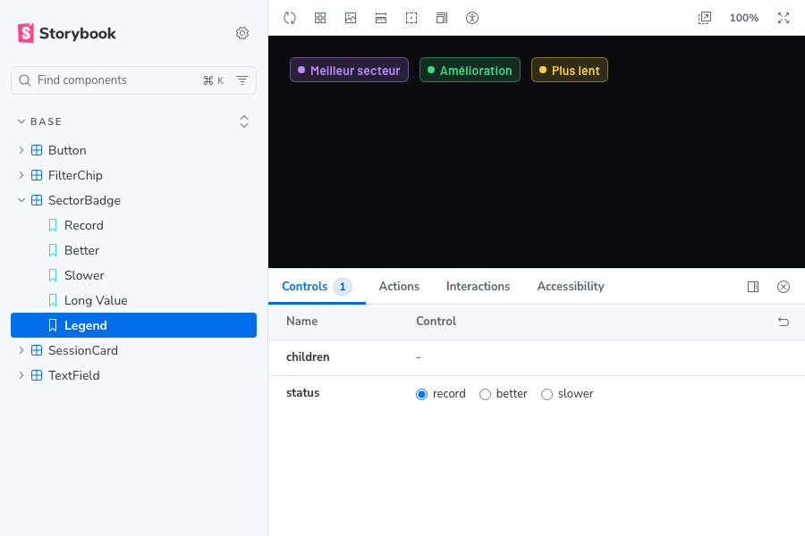
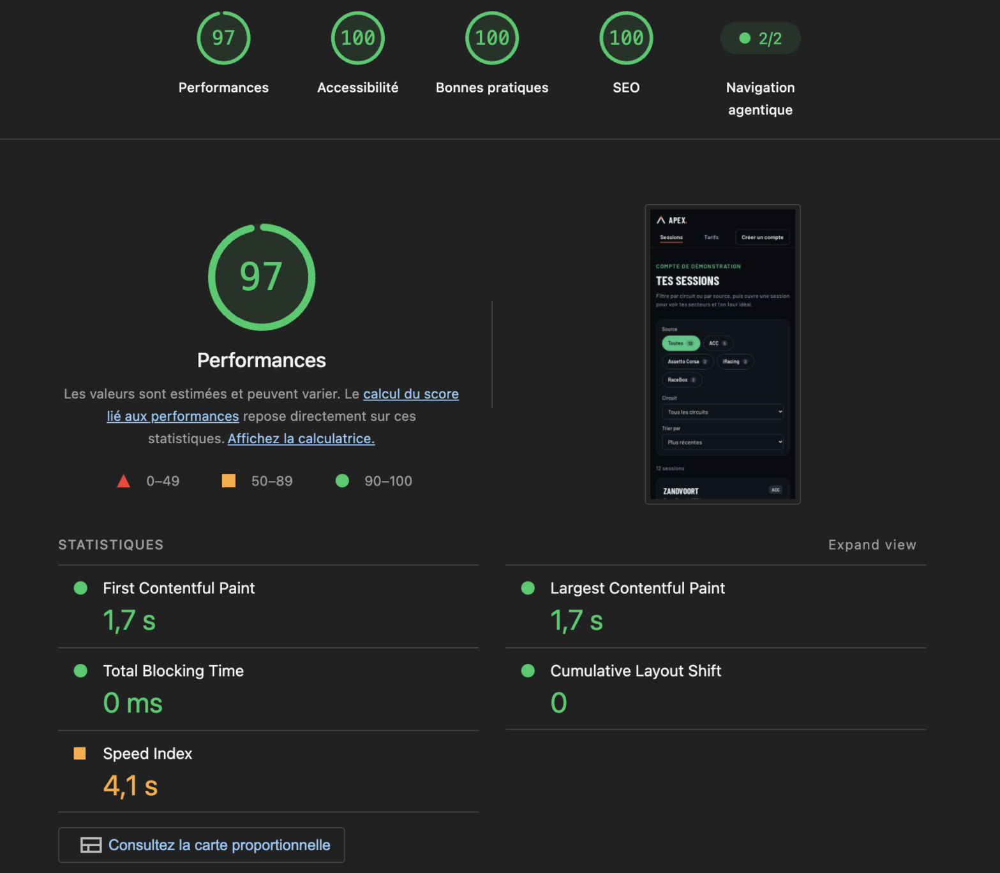
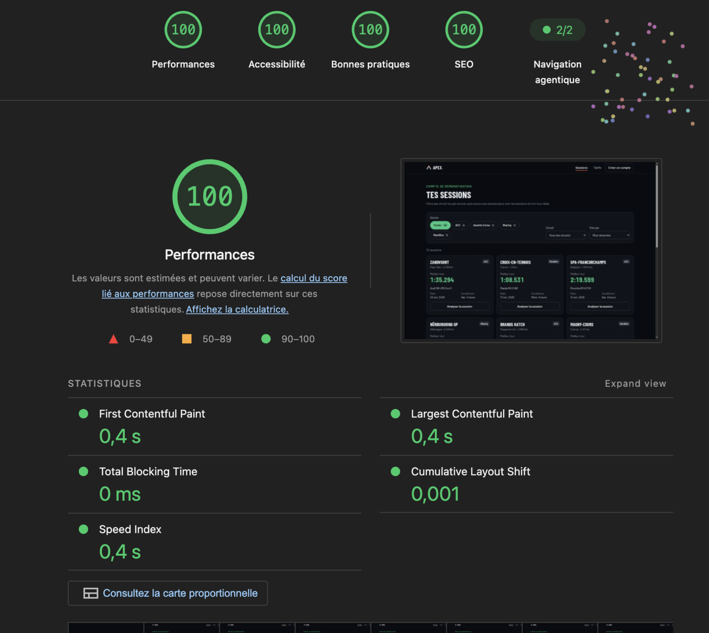

# Dossier de projet — Apex Telemetry

Ethan Rieu · ESGI Reims · TailwindCSS & SASS

- Site en ligne : **À COMPLÉTER (lien Vercel)**
- Dépôt Git : https://github.com/EthanRieu/Apex-telemetry

> Les passages marqués **À COMPLÉTER** dépendent de ce que tu feras toi-même : tests avec de vraies personnes, croquis, Lighthouse sur la version en ligne. Ne les invente pas : c'est ce qui fait perdre le plus de points.

## 1. Cadrage

| | |
|---|---|
| Client | **Apex Telemetry**, fictif · SaaS · Reims · 3 personnes |
| Services | Gratuit 0 € · Pilote 6 €/mois · Team 19 €/mois · Analyse coaching 29 € une fois |
| Objectif | Obtenir des inscriptions en ligne à l'offre Pilote |
| Ambiance | Précis, nerveux, nocturne · noir carbone, rouge signal, vert chrono |

## 2. Personas et missions

| | Thomas | Julie |
|---|---|---|
| Qui | 24 ans, étudiant, simracer ACC 4 soirs par semaine | 38 ans, infirmière, 6 trackdays par an en Alpine avec une RaceBox |
| Contexte d'usage | Chez lui, sur ordinateur, entre deux relais | Au paddock, sur téléphone, plein soleil, entre deux sessions |
| Ce qu'il/elle veut | Savoir où il perd du temps | S'abonner sans se faire piéger |
| Ce qui le/la gêne | Les courbes de télémétrie illisibles | Les prix cachés, les formulaires longs sur mobile |
| **Mission** | **Sur ordinateur, ouvrir sa dernière session à Spa et trouver son secteur le plus coûteux en moins de 30 s** | **Sur téléphone, s'inscrire à l'offre Pilote en moins de 2 min, sans erreur** |
| Parcours | Accueil → Sessions → filtre circuit « Spa » → détail (modale) | Accueil → Tarifs → Inscription → Confirmation |

## 3. Écrans

| Écran | Rôle | Persona |
|---|---|---|
| Accueil | Proposition de valeur, CTA « Choisir mon offre », aperçu réel d'une analyse | les deux |
| Sessions | Écran interactif : filtre source × filtre circuit, tri, détail en modale, état vide | Thomas |
| Tarifs | Les 4 offres, prix TTC, sans engagement | Julie |
| Inscription | Formulaire : offre, prénom, e-mail, mot de passe, CGU ; erreurs, chargement, confirmation | Julie |

**Croquis :** À COMPLÉTER (photo de tes croquis papier).

| Mobile 375 px | Ordinateur |
|---|---|
| {width=45%} |  |
| {width=45%} |  |
| {width=45%} |  |

## 4. Design system

**Tokens (`src/index.css`, `@theme`)**

| Rôle | Token | Valeur |
|---|---|---|
| Fond | `carbon-950 … carbon-600` | `#0A0C10` → `#3A4150` |
| Texte | `ink`, `ink-muted` | `#F2F4F8`, `#A3ACBD` |
| Principale | `signal-300 … signal-700` | `#FF8A80` → `#8F0400` (boutons : `signal-600`, contraste 6,2:1) |
| Accent | `chrono-300 … chrono-500` | `#8FF0B8` → `#1FB866` |
| Secteurs | `sector-record / better / slower` | violet, vert, jaune |
| Police | `font-sans` / `font-display` | Barlow / Barlow Condensed (auto-hébergées) |

**Composants de base** (tous dans Storybook, avec leurs états) : `Button` (primaire, secondaire, discret, désactivé, chargement, lien, libellé long), `FilterChip` (sélectionné, compteur, désactivé), `TextField` (aide, erreur, désactivé, contenu long), `SessionCard` (pluie, circuit réel, contenu long), `SectorBadge` (3 statuts, en SASS).

Chaque story est testée automatiquement (`npm test`) : rendu + audit axe, **0 violation** sur 32 stories.

{width=48%} {width=48%}

## 5. Tests utilisateurs

À COMPLÉTER après les tests réels (2 minimum, une personne par persona, qui ne connaît pas le site).

| | Test 1 (mission de Thomas) | Test 2 (mission de Julie) |
|---|---|---|
| Qui | … (ex. camarade d'une autre classe, joue à ACC) | … (ex. un proche, sur son propre téléphone) |
| Appareil | ordinateur | téléphone |
| Temps | 16 s | 1 min 12 s |
| Réussite | oui | oui |
| Observé | Rien de notable | Rien de notable |
| Corrigé | Rien de notable | Rien de notable |
| Temps au 2e test | Pas nécessaire | Pas nécessaire |

## 6. Trois choix justifiés

1. J'ai mis le **temps du tour juste après son numéro** dans le tableau du détail (avant les secteurs) parce que Thomas cherche d'abord son meilleur tour ; sur mobile, le tableau défile et les colonnes de droite sont masquées. Le test a montré que cela a bien fonctionné il a facilement trouvé le tour le plus rapide
2. J'ai ajouté un **écran Tarifs séparé, avec les prix TTC et « sans engagement »**, parce que Julie ne veut pas donner son e-mail avant de connaître le prix. Le test a montré que cela a bien fonctionné elle a facilement trouvé les tarifs adaptés à son budget
3. J'ai doublé la **couleur des secteurs d'une pastille et d'un texte pour lecteur d'écran**, et ajouté une légende, parce que Julie lit son écran en plein soleil et que la couleur seule ne suffit pas. Le test a montré que cela a bien fonctionné elle a facilement trouvé les couleurs adaptées à son écran

## 7. Qualité

**Lighthouse sur la version en ligne** (écran Sessions, navigation privée) :

| | Performance | Accessibilité | Bonnes pratiques | SEO |
|---|---|---|---|---|
| **Mobile** | **97** | **100** | **100** | **100** |
| Ordinateur | 100 | 100 | 100 | 100 |

{width=48%} {width=48%}

Sur mobile : FCP et LCP 1,7 s, TBT 0 ms, CLS 0. Seul le Speed Index (4,1 s) est orange : c'est la conséquence du réseau mobile lent simulé par Lighthouse, alors qu'il est de 0,4 s sur ordinateur.

Ce que j'ai corrigé :
- **SEO 91 → 100** : Lighthouse ne trouvait pas de `robots.txt` valide → ajout de `public/robots.txt`.
- **Un premier audit donnait Performance 80 et Bonnes pratiques 77.** L'analyse a montré que ces mauvais scores ne venaient pas du site mais d'une extension Chrome : son script injecté (`contentscript.js`) apportait l'API obsolète, l'erreur de CSP et 1,1 Mo de JavaScript inutilisé. J'ai refait l'audit en navigation privée, sans extension, pour mesurer le site seul.
- **Ne jamais auditer `npm run dev`** : en local, le serveur de dev donne Performance 48 (code non minifié), contre 98 pour le build de production.

Autres corrections faites pendant l'intégration :
- les couleurs de secteur n'apparaissaient pas : Tailwind 4 n'émet que les variables de thème utilisées par ses classes ; elles sont lues uniquement par le SASS → `@theme static` ;
- l'ordre des titres (h1 → h3) signalé par axe sur l'écran Sessions → titres des cartes en h2 ;
- la modale prenait 90 % de la hauteur même avec peu de contenu → `h-fit` au lieu de `h-auto`.

## 8. Utilisation de l'IA

J'ai utilisé Claude code en Opus 5.5 High pour : la création du site web + remise en forme de texte, création des storybook ainsi que des exemples de missions

J'ai réalisé et cadré le projet, définit les besoins fonctionnels, proposer un design visuellement cohérent et adapté à mon projet APEX. J'ai également décider des différents écrans nécessaire ainsi que des différents tarifs (Le business plan).

Le design system à été décidé en collaboration avec Claude code, en utilisant mes besoins fonctionnels et mes préférences visuellement cohérentes.

J'ai également fais faire les tests à des camarades de classe pour vérifier si mes objetifs de mission pour les personna fonctionnent dans des conditions réelles.